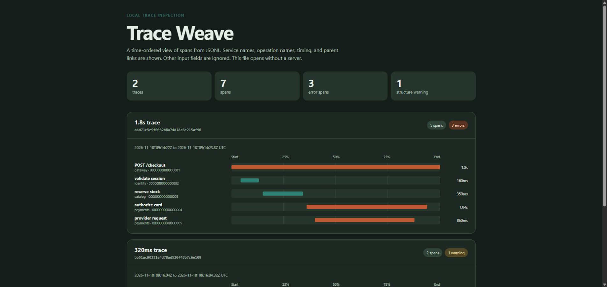

# Trace Weave

Trace Weave turns interleaved span logs into a timeline you can open locally. It is for the moment when a request crosses several services and the log lines are readable one by one but the order of work is hard to see.

The [sample report](https://musyase.github.io/trace-weave/demo.html) shows a fictional checkout request with a slow payment call and a second trace with a missing parent span. The report is a single HTML file with no scripts, external assets, or server requirement.



## Try it

Requires Go 1.23 or newer. From the repository root:

```bash
go run ./cmd/trace-weave -input sample/checkout.jsonl
go run ./cmd/trace-weave -input sample/checkout.jsonl -format html -output report.html
go run ./cmd/trace-weave -input sample/checkout.jsonl -format json -output report.json
```

Open `report.html` in a browser. To inspect one request, add `-trace a4d71c5e9f0032b8a74d18c6e215af90`. Omit `-input` to read JSONL from standard input. Omit `-output` to write to standard output.

The text output for the sample begins with:

```text
a4d71c5e9f0032b8a74d18c6e215af90  1.8s  spans=5  errors=3  warnings=0
bb51ac90231e4d78ad520f43b7c6e109  320ms  spans=2  errors=0  warnings=1
```

## Input

Each line is one JSON object. `trace_id` uses 32 hexadecimal characters and `span_id` and `parent_span_id` use 16. `parent_span_id` is optional for a root span. Timestamps use RFC3339 and may include fractional seconds and time zone offsets.

```json
{"trace_id":"a4d71c5e9f0032b8a74d18c6e215af90","span_id":"0000000000000004","parent_span_id":"0000000000000001","service":"payments","name":"authorize card","start":"2026-11-18T09:14:22.65Z","end":"2026-11-18T09:14:23.69Z","status":"error"}
```

`status` may be `ok`, `error`, or `unset`; omitted status becomes `unset`. Other fields are ignored, so payload attributes are not copied into the report. Service names and operation names do appear in output. Remove sensitive values from those names before sharing a report.

Trace Weave marks duplicate span IDs, missing parents, parent cycles, negative durations, multiple roots, and spans outside a parent's time range. A warning is a lead for investigation. An unusual span range does not prove clock skew. Input is limited to 50,000 spans and 1 MiB per line; all spans are held in memory while the report is built. This is a compact inspection tool, not an OTLP collector or a continuous tracing backend.

## Inspect the implementation

- [`internal/trace/trace.go`](internal/trace/trace.go) validates JSONL and groups spans without relying on input order.
- [`internal/render/html.go`](internal/render/html.go) calculates timeline bars and uses Go's HTML template escaping for labels.
- [`internal/trace/trace_test.go`](internal/trace/trace_test.go) exercises missing parents, cycles, duplicate IDs, malformed input, and terminal control characters.
- [`internal/render/html_test.go`](internal/render/html_test.go) checks HTML escaping with hostile labels.

Run `go test ./...` and `go vet ./...`. The [CI workflow](https://github.com/musyase/trace-weave/actions/workflows/check.yml) runs both on every push and pull request. The checked-in HTML sample is generated from `sample/checkout.jsonl` using the command above.
